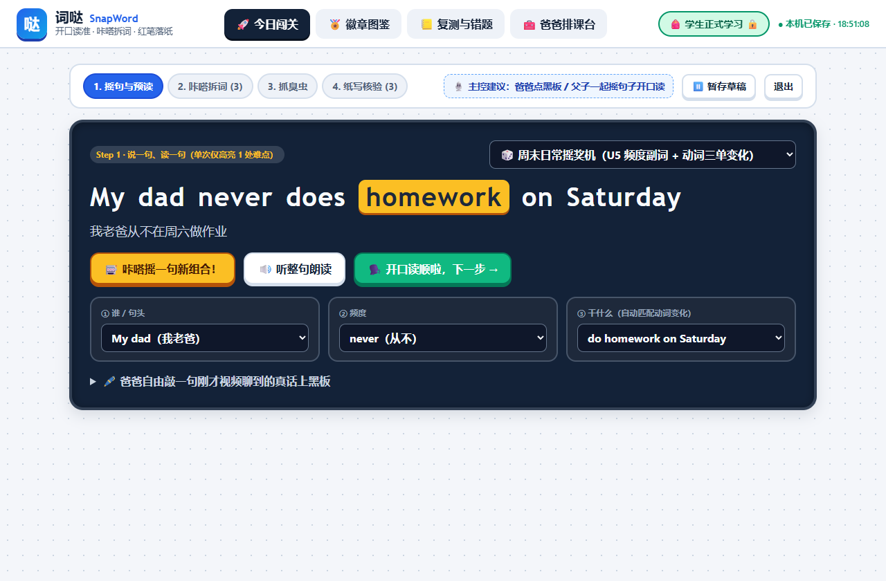
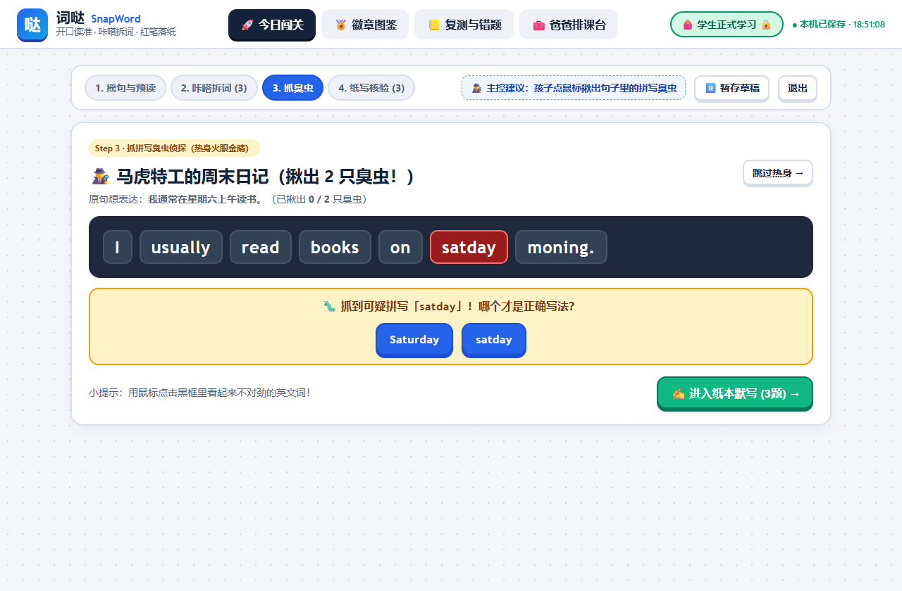
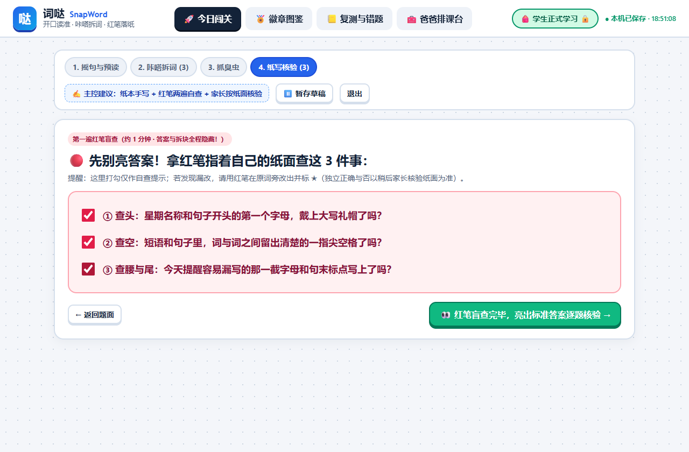

# 词哒 · SnapWord

> **面向小学英语起步与补差阶段的「趣味磁吸拆词 + 亲子同屏黑板 + 两遍红笔落纸」轻量伴学工作台**  
> A playful, zero-frustration, offline-first English word chunking & parent-child companion workbench that bridges spoken English, visual word blocks, and real pen-and-paper mastery.


---

## 为什么做「词哒」· Why SnapWord?

很多小学中高年级孩子（尤其是启蒙期缺乏自然拼读引导、或经历过跨教材转换的学生）在记英语单词时会陷入两个极端：
- **死抄硬背型**：把 `Saturday` 当成 8 个毫无逻辑的乱码字母抄写二十遍，过几天提笔又靠耳朵瞎猜写成 `satday`、`homewalk`、`footbool`；
- **重度游戏干扰型**：用扣血条、倒计时和吵闹音效逼孩子在电脑键盘上盲打整词——基础弱的孩子连错两题就崩盘受挫，而且键盘敲对了，到了考场纸面上依然漏大写、漏空格。

**词哒（SnapWord）** 把“枯燥复读、死背拼写、被动挨批”改造成了 **15 分钟安静、零挫败、最终稳稳落回纸本** 的四个趣味小机关：

1. **🎰 老爸整蛊造句机 & 同屏大黑板**：三个滚轮摇出语法正确又好笑的生活真句（自动处理第三人称单数 `do/does`、`play/plays`），把父母日常跟孩子聊的“空中口语”变成屏幕上看得见的大字，单次只高亮 1 处重点。
2. **🧲 咔嗒磁吸拆词台（按需支架）**：先听整词发音，再用鼠标把磁吸词块（如 `Sat ｜ ur ｜ day`、`home + work`、短语空格块 `␣`）“咔嗒”吸合归位。点到伪装块不扣分，只会俏皮弹回提醒；已经会写的词支持**一键跳过直达纸写**。
3. **🕵️ 15 秒抓拼写臭虫侦探**：让孩子当小侦探，在“马虎特工字条”里揪出 `satday`、`footbool`、`uplate` 等常见拼写臭虫并拍扁修正，为拿红笔检查自己的作业预热。
4. **🔴 两遍红笔自查 & 跨日金徽章**：最后报 3–5 题让孩子在真实纸本上手写 → **第 1 遍不亮答案**，引导孩子拿红笔盲查大写、空格与易漏块 → **第 2 遍亮出答案**圈改并遮盖重写。只有**在至少两个不同日期纸上无提示独立写对**，才能点亮最高级的 **金章 🥇**。

---

## 界面预览 · Screenshots (`v0.1.3`)

| 今日闯关大厅与金银铜徽章栏 | 老爸整蛊造句机与同屏口语黑板 |
| :---: | :---: |
|  |  |

| 咔嗒磁吸拆词与俏皮弹回提示 | 抓拼写臭虫侦探热身卡 |
| :---: | :---: |
|  |  |

| 纸本手写与第一遍红笔盲查清单（答案严密隐藏） |
| :---: |
|  |

---

## 核心工程特性 · Key Highlights

- **零服务器、双击即用**：打包产物 `dist/SnapWord-词哒.html` 内嵌样式、逻辑与公开授权真人发音，无需安装环境、无需联网注册，双击即可在 Chrome / Edge 全屏运行；同时生成 `dist/index.html` 可直接托管至 GitHub Pages。
- **远程视频伴学友好（无背景音效干扰 & 防抢鼠标）**：剔除嘈杂背景战斗音效以降低远程免提通话串音风险（内置目标设备 1 分钟试听核验卡，便于实机确认外放与通话音量配合）；界面清晰提示每个环节由家长还是孩子主控鼠标。
- **严谨可信的纸笔账本与防污染隔离**：纸写核对默认处于「未判定」并严格按已测已核验口径统计；课前到期词优先独立盲写防泄题；顶栏内置 **「🎒 学生正式学习 / 🛠️ 家长演练试用」** 持久化身份锁定，杜绝测试点击污染孩子的徽章进度与 `D0+1 / D0+3 / D0+7` 复测日历。
- **三栏透明排课与四分类备份预览**：支持按 `英文 | 中文` 快速粘贴建包并按本班要求自动分流为「本轮纸写 / 仅听读认义 / 超容量下轮候选」；支持半课刷新草稿恢复、JSON 备份四分类差异预览（含待核验升级合并）及旧版词单隔离提取。

---

## 快速开始 · Quick Start

### 方式一：直接打开便携单文件（推荐家庭日常使用）
直接用 Chrome 或 Edge 浏览器打开仓库中的 `dist/SnapWord-词哒.html`（Windows 下也可双击根目录 `启动词哒工作台.cmd`）。

### 方式二：从源码修改与重新构建
项目采用零第三方前端框架依赖的原生模块化结构，使用 Python 3 标准库即可完成打包：

```bash
# 1. 重新打包生成 dist/SnapWord-词哒.html 与 dist/index.html
python tools/build.py

# 2. 运行核心状态机单元测试与离线浏览器端到端回归测试
node tests/verify_snapword.cjs
```

---

## 目录结构 · Project Structure

```text
词哒-SnapWord/
├── src/
│   ├── index.html          # 应用主骨架与顶栏模式隔离控件
│   ├── style.css           # 高对比护眼工作台样式与磁吸微动效
│   ├── curriculum.js       # 内置分级题库（基线短测 + 秋假特训 + 五上 U5/U6 词表 + 造句机/抓虫卡）
│   ├── core.js             # 纯函数状态机：金银铜跨日判定、D+1/3/7 队列、防污染隔离与备份合并
│   ├── audio.js            # 音源分级播放器（自带录音 > 内置 CC 真人音 > 系统合成朗读）
│   └── app.js              # 四步向导交互、两遍红笔核对台与家长排课台控制器
├── audio/
│   ├── attribution.json    # 内置真人发音来源、作者与 CC 许可证明细
│   └── *.mp3               # 来自 Wikimedia Commons 的公开授权真人发音切片
├── tools/
│   ├── build.py            # 单文件离线便携包构建脚本
│   └── fetch_audio.py      # Wiktionary / Wikimedia 公开授权发音检索与转换工具
├── tests/
│   └── verify_snapword.cjs # 单元测试 + 离线 Chromium 全链路自动化验证脚本
├── docs/
│   ├── ROADMAP.md          # 版本演进路线图
│   └── media/              # 实机界面截图
├── dist/                   # 构建产物（SnapWord-词哒.html / index.html）
├── CHANGELOG.md            # 版本更新日志
└── LICENSE                 # MIT 开源许可证及第三方公开音频署名说明
```

---

## 开源许可与致谢 · License & Attribution

- 本项目源代码采用 **[MIT License](LICENSE)** 开源，欢迎家长、一线英语教师与开发者自由使用、修改题库或二次开发。
- `audio/` 目录下收录的真人单词发音来自 [Wikimedia Commons](https://commons.wikimedia.org/) 与英文维基词典社区贡献者，分别遵循 `Public Domain`、`CC0`、`CC BY 3.0/4.0` 或 `CC BY-SA 3.0/4.0` 协议；完整逐词作者与许可链接见 [`audio/attribution.json`](audio/attribution.json) 及应用内「排课台 → 授权署名」面板。
